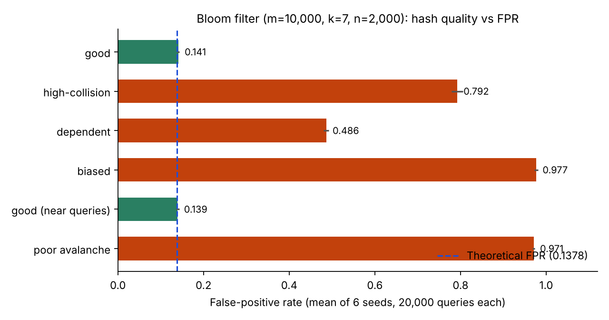

# Bloom Filter Hash Quality

How much does the quality of the hash functions change a Bloom filter's false-positive rate (FPR)? This project builds a Bloom filter from scratch and breaks one hash property at a time: collision rate, independence, distribution, and avalanche effect.



Setup: `m = 10,000` bits, `k = 7` hash functions, `n = 2,000` inserted keys, 20,000 query keys. With ideal hashing the FPR is `(1 - e^(-kn/m))^k = 0.1378`.

| Property tested | Hash family | Mean FPR (6 seeds) | Bit occupancy |
|---|---|---|---|
| Baseline | SHA-256 with a per-function salt | 0.141 | 0.755 |
| (a) Collisions | SHA-256 truncated to 12 bits | 0.792 | 0.396 |
| (b) Independence | one base hash + `i * 13` | 0.486 | 0.755 |
| (c) Distribution | `mod m/4`, so only a quarter of the bits are ever used | 0.977 | 0.249 |
| (d) Avalanche | byte-sum with shifts, on one-character-edit queries | 0.971 | 0.172 |
| (d) Baseline | SHA-256, same near-miss queries | 0.139 | 0.755 |

Good hashing lands within about 0.003 of the theoretical FPR. Each flawed family is far worse, and the failure shows up in a different way. Collisions and bad distribution shrink the number of distinct bits used (low occupancy, so the filter saturates the few it does use). Dependent hashes fill the array normally but all `k` positions move together, so a query matches whenever its base hash lands near an inserted one.

## Run it

```bash
python bloom_filter.py 42     # one seed, writes results/results_seed42.json
python make_chart.py          # rebuilds assets/fpr_by_hash.png from results/summary.csv
```

`results/summary.csv` aggregates seeds 1-5 and 42 (mean and population standard deviation).

## Files

| File | Purpose |
|---|---|
| `bloom_filter.py` | Bloom filter class, five hash families, data generators, experiment runner |
| `results/` | Per-seed JSON and the aggregated `summary.csv` |
| `make_chart.py` | Builds the chart |

## Notes

- The original Colab notebook reported 0.136 (good), 0.783, 0.496, 0.978 and 0.971 for the flawed families from a single run. This repo reruns the experiments as a script across six seeds, so the numbers differ slightly from the single-run notebook values but tell the same story.
- Keys are random 12-character alphanumeric strings; "near" queries change exactly one character of an inserted key.
- The poor-avalanche hash is deliberately weak and exists only to demonstrate the failure mode.

## Notebooks

[`notebooks/Bloom_filter.ipynb`](notebooks/Bloom_filter.ipynb) is the original assignment notebook with its saved outputs (single run: good hash 0.136, flawed families 0.78, 0.50, 0.98 and 0.97). `bloom_filter.py` is the cleaned, seeded script version.

## Stack

`Python` `hashlib` `matplotlib`
